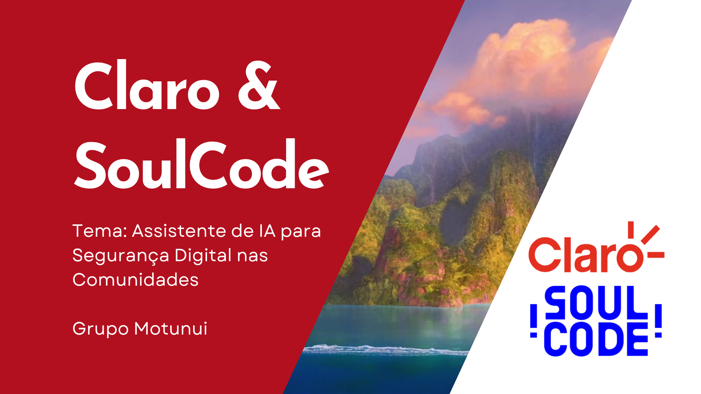

# 🛡️ Assistente de IA para Segurança Digital - Projeto Motunui

  <b>Chatbot inteligente desenvolvido para orientar usuários sobre golpes digitais, fraudes, privacidade e uso seguro da internet.</b>

---

## 🚀 Sobre o Projeto
O **Projeto Motunui** foi desenvolvido em parceria com a **SoulCode** e com temática voltada à **Claro**. O objetivo principal é criar uma interface de chatbot interativa que atue como uma assistente virtual de segurança digital, ajudando comunidades a identificarem e se protegerem contra fraudes e golpes virtuais.

---

## 🎯 Objetivos Principais
* Orientar usuários sobre prevenção contra golpes digitais e fraudes online.
* Promover a conscientização sobre privacidade e boas práticas de navegação.
* Fornecer um canal acessível e prático para esclarecer dúvidas sobre segurança da informação.

---

## 🛠️ Tecnologias Utilizadas
* **Front-end:** HTML, CSS, JavaScript (React)
* **Inteligência Artificial:** Integração com LLM / Chatbot
* **Controle de Versão:** Git e GitHub

---

## 👥 Integrantes do Grupo Motunui
* **Suzane Marcelly Albino** - [LinkedIn](https://linkedin.com/in/suzanemarcellyalbino)
* **Aline Damasceno** - [LinkedIn](https://linkedin.com/in/aline-damasceno-6a08aa158)
* **Carolyn Aviz** - [LinkedIn](https://linkedin.com/in/carolyn-aviz)
* **Laura Almeida** - [LinkedIn](https://linkedin.com/in/laura-c-almeida-78a81731)

---
